# BattleTech: a mercenary company

**English** · [Русский](#русский)

A turn-based mech game in the browser: hex battles decided by dice rolls, and a campaign for a
mercenary company in a living Inner Sphere at war. Unofficial, non-commercial fan project.

**▶ Play: [rapulse.github.io/battletech](https://rapulse.github.io/battletech/)** — no installation, saves stay in your browser.

## The story behind it

As kids, a friend and I devoured the BattleTech novels. Inspired by them, we invented a tabletop
game of our own — with our own rules, a hex map and a handful of dice. We had no idea back then that
a real BattleTech board game existed.

This project is that childhood game brought to the screen. Wherever our old rules had gaps, they
are filled in with the rules of the original BattleTech. The computer rolls the dice now: hits,
critical damage, falls, overheating — everything that used to hang on a throw is resolved
automatically, and all that is left for you is to command.

## What the game is about

You start as the commander of a small mercenary company: three battered mechs, a leased DropShip
and a debt to pay off. Fly across the Inner Sphere, take contracts, fight, repair and refit your
machines. Which path to take is up to you: clear the Sphere of pirates, serve the Great Houses, or
even the Clans.

The world around you never stands still. States are constantly at war, borders shift, rival
companies take the work you were hoping for — and every action you take leaves its mark on that
world. Once your company is strong enough, you can found a realm of your own and compete with the
states of the Inner Sphere, all the way to the goal of the game: restoring the Star League.

> **Tip.** With a bit of luck, your starting company already has a Clan warrior: hits land more
> often and the first battles are easier. Try campaign seed **49646175** on the founding screen.

## Getting started

### 1. Main menu

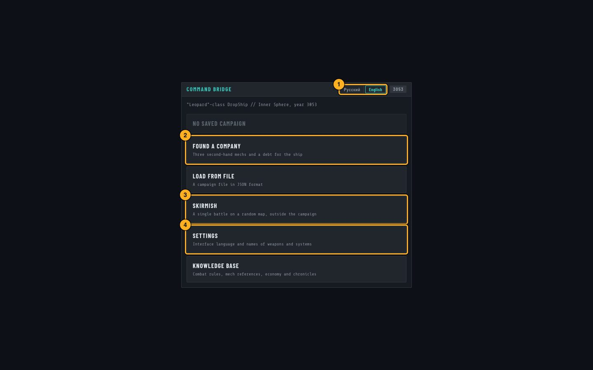

1. **Language.** The game speaks English and Russian; one click switches the interface and the
   names of weapons. Separate settings for each live in **Settings** (4).
2. **Found a company** — start a campaign.
3. **Skirmish** — a single battle on a random map, outside the campaign. A good way to learn the
   combat rules.
4. **Settings** — the interface language and the language of weapon and equipment names, separately.

### 2. Founding a company

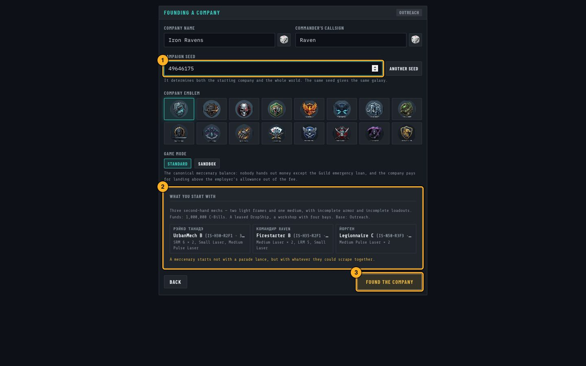

1. **Campaign seed.** It defines both the starting company and the whole galaxy: the same seed
   always gives the same world.
2. **What you start with** — your mechs, their pilots and loadouts.
3. **Found the company** — off you go.

### 3. Hangar

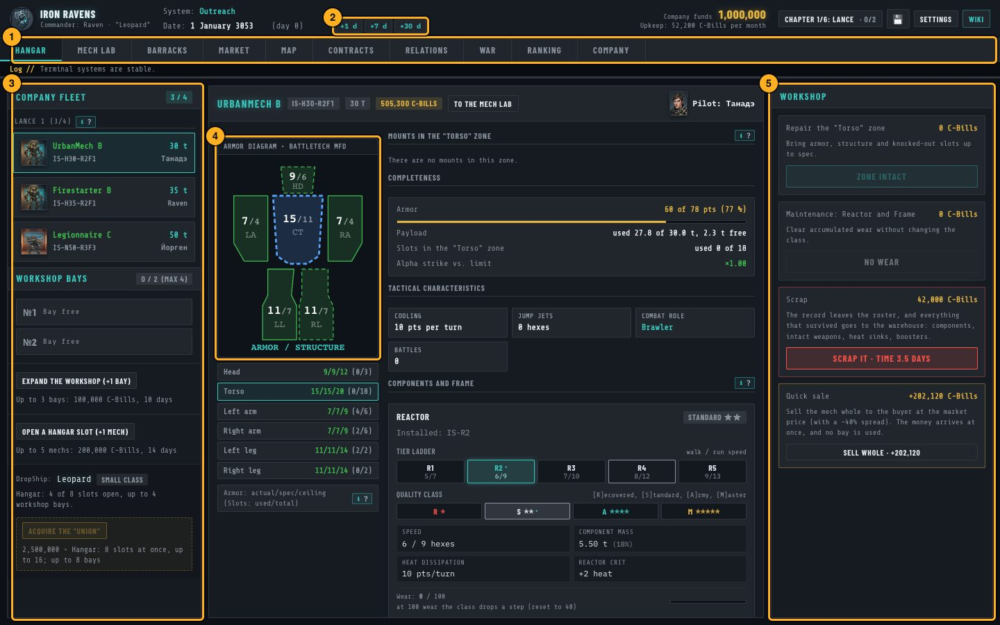

1. **Tabs** of the company: hangar, mech lab, barracks, market, star map, contracts and more.
2. **Time.** Time only moves when you say so: +1, +7 or +30 days. Repairs, travel and the war
   in the background all advance with these buttons.
3. **Your fleet** and the workshop bays.
4. **Armor diagram** of the selected mech: armor and structure by location.
5. **Workshop** — repairs, maintenance, scrapping or selling a mech.

### 4. Star map and travel


1. **Map layers**: the war front, pirate hotbeds, job scale, where gear is cheapest. The pirate layer
   shows where there is work for a young company.
2. **Plot a course** to the selected world: the dossier shows the jumps, travel time and cost.
3. Then move time forward with **+7 d** until you arrive.

### 5. Contracts

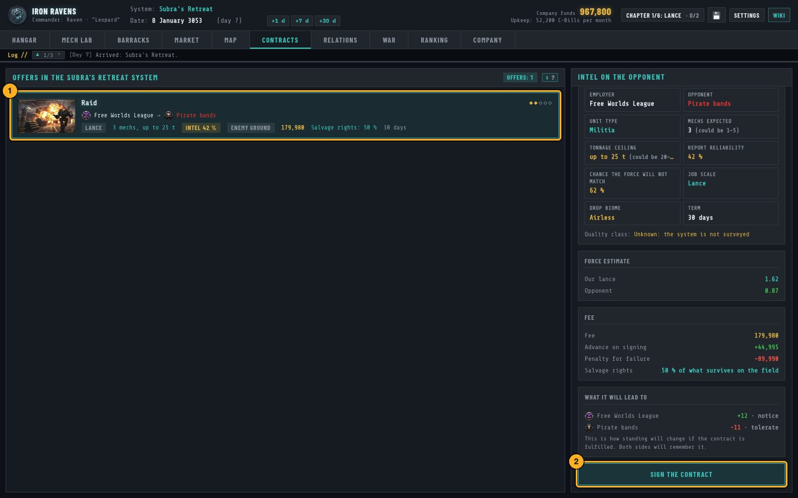

1. **Offers** in the current system: employer, opponent, pay, salvage rights, term.
2. **Sign the contract** after reading the intel on the opponent. The battle itself starts from
   this screen once you have deployed your lance.

### 6. Battle

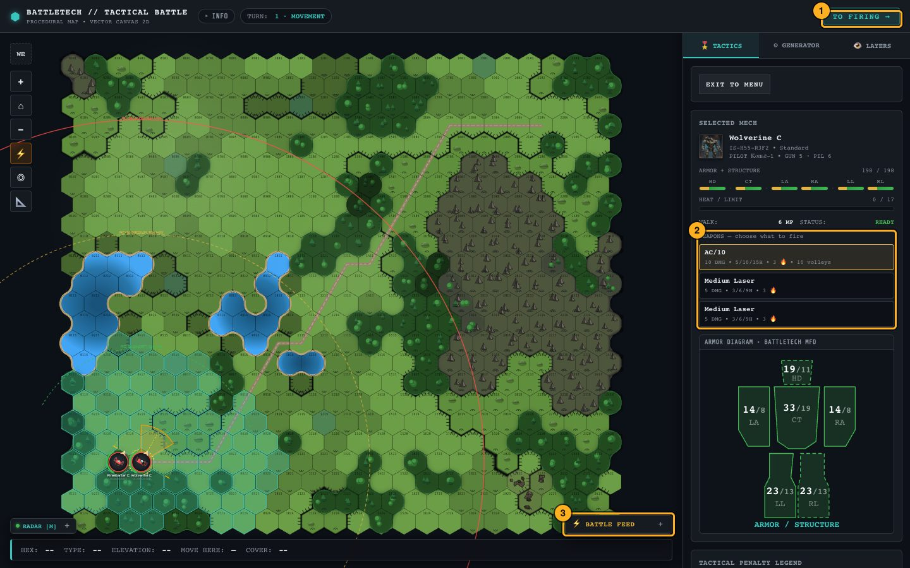

Click your mech, then a hex to move. Forests, water, hills and buildings change both movement and
cover.

1. **Phase button**: from movement to firing and on to the next turn.
2. **Weapons** of the selected mech: choose what to fire, then click an enemy. Each weapon shows
   its damage, range brackets and heat.
3. **Battle feed** — every roll with its breakdown: what was needed, what came up, where it hit.

### 7. Your realm

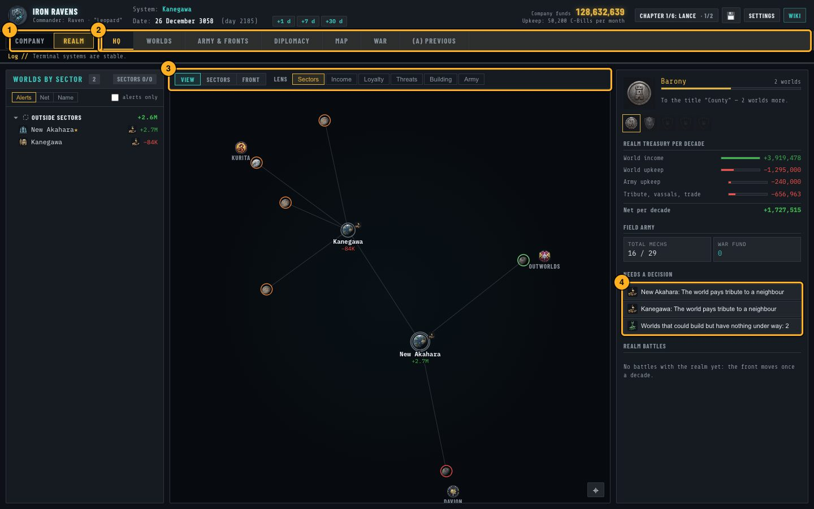

1. **Company / Realm** — two sets of tabs: the company's affairs and the affairs of the state.
2. **Realm tabs**: headquarters, worlds, army and fronts, diplomacy.
3. **Map lenses**: sectors, income, loyalty, threats, construction, army.
4. **Needs a decision** — what the realm is waiting for from you right now.

## For developers

TypeScript + Vite + Svelte 5 + Canvas 2D, tests on Vitest. The game core (`game/src/core/`) does not
know about the UI, all state changes go through commands, and every roll uses a seeded random
generator — so any battle and any campaign can be reproduced from its seed.

```bash
cd game
pnpm install
pnpm dev      # the game at http://localhost:5173
pnpm check    # types, Svelte, linter and all tests
```

Requires Node.js 24 and pnpm 11. The documentation is in Russian: `game_core.md` — architecture,
`wiki/` — game design and rules, `wiki/overview/corridors.md` — balance, `CLAUDE.md` — working rules
for the project. Publishing the game: `tools/deploy.md`. The screenshots above are made by
`game/scripts/readme-shots.mjs`.

BattleTech is a registered trademark of its respective owners. This is a non-commercial fan
project, not affiliated with or endorsed by them.

---

# Русский

[English](#battletech-a-mercenary-company) · **Русский**

Пошаговая игра про боевых роботов в браузере: бои на гексах, которые решают броски кубиков, и
кампания наёмного отряда в живой, воюющей Внутренней Сфере. Неофициальный некоммерческий
фанатский проект.

**▶ Играть: [rapulse.github.io/battletech](https://rapulse.github.io/battletech/)** — без установки, сохранения хранятся в браузере.

## С чего всё началось

В детстве мы с другом зачитывались книгами из серии BattleTech. Под впечатлением от них мы
придумали собственную настольную игру — со своими правилами, гексами и горстью кубиков. О том, что
настоящая настольная BattleTech существует, мы тогда даже не знали.

Этот проект — та самая игра из детства, перенесённая на экран. Там, где в наших правилах были
пробелы, их заполнили правила оригинальной BattleTech. Кубики теперь бросает компьютер: попадания,
критические повреждения, падения, перегрев — всё, что раньше зависело от броска, считается
автоматически, а вам остаётся командовать.

## О чём игра

Вы начинаете командиром небольшого отряда наёмников: три потрёпанных меха, десантный корабль в
аренде и долг, который надо отдавать. Летайте по Внутренней Сфере, берите контракты, сражайтесь,
чините и перевооружайте машины. Каким путём идти — решать вам: зачищать Сферу от пиратов, служить
Великим Домам или даже кланам.

Мир вокруг не стоит на месте. Государства непрерывно воюют, границы сдвигаются, соперники
перехватывают работу — и каждое ваше действие оставляет в этом мире след. Когда отряд окрепнет,
можно основать собственную державу и потягаться с государствами Внутренней Сферы — вплоть до цели
игры: восстановить Звёздную лигу.

> **Совет.** Если повезёт, уже в стартовом отряде окажется воин кланов: попадания чаще, первые бои
> проще. Попробуйте сид кампании **49646175** на экране основания отряда.

## Первые шаги

### 1. Главное меню

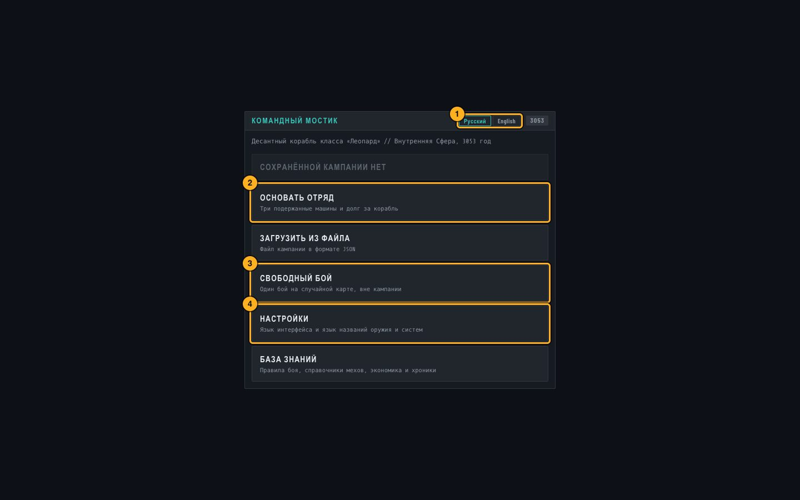

1. **Язык.** Игра говорит по-русски и по-английски; один щелчок переключает интерфейс и названия
   оружия. По отдельности они настраиваются в **Настройках** (4).
2. **Основать отряд** — начать кампанию.
3. **Свободный бой** — один бой на случайной карте, вне кампании. Хороший способ освоить правила
   боя.
4. **Настройки** — язык интерфейса и язык названий оружия и систем, по отдельности.

### 2. Основание отряда

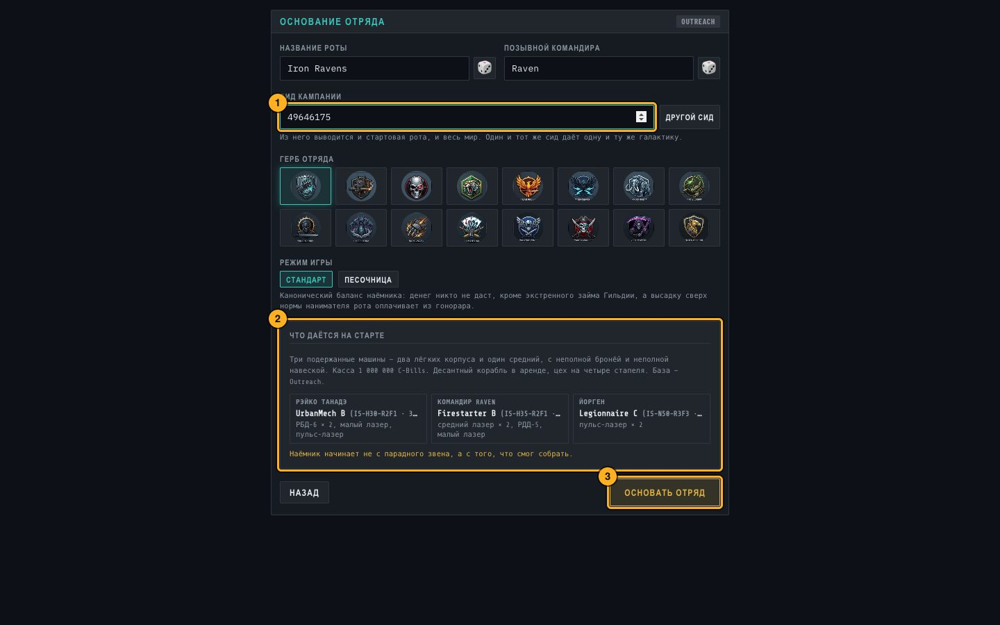

1. **Сид кампании.** Из него выводятся и стартовый отряд, и вся галактика: один и тот же сид всегда
   даёт один и тот же мир.
2. **Что даётся на старте** — машины, их пилоты и вооружение.
3. **Основать отряд** — в путь.

### 3. Ангар

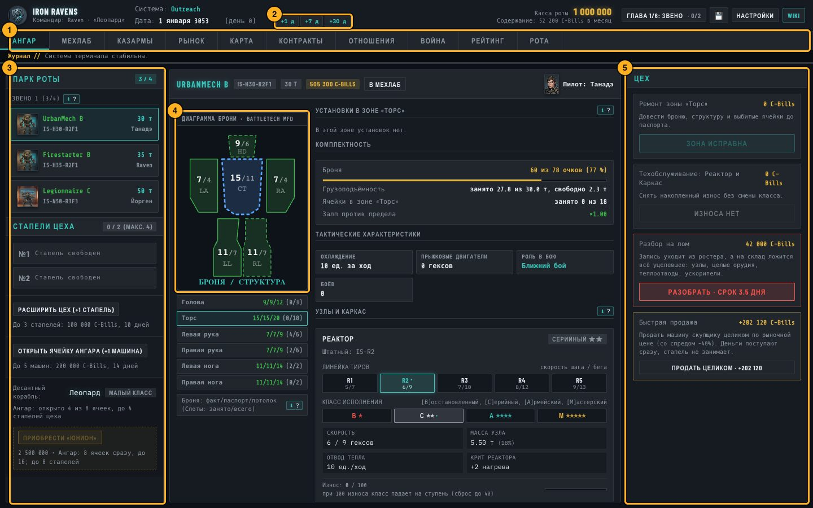

1. **Вкладки** отряда: ангар, мехлаб, казармы, рынок, звёздная карта, контракты и другие.
2. **Время.** Время идёт только по вашей команде: +1, +7 или +30 дней. Ремонт, перелёты и война на
   фоне движутся этими кнопками.
3. **Ваш парк** и стапели цеха.
4. **Диаграмма брони** выбранной машины: броня и структура по зонам.
5. **Цех** — ремонт, обслуживание, разборка или продажа машины.

### 4. Звёздная карта и перелёты

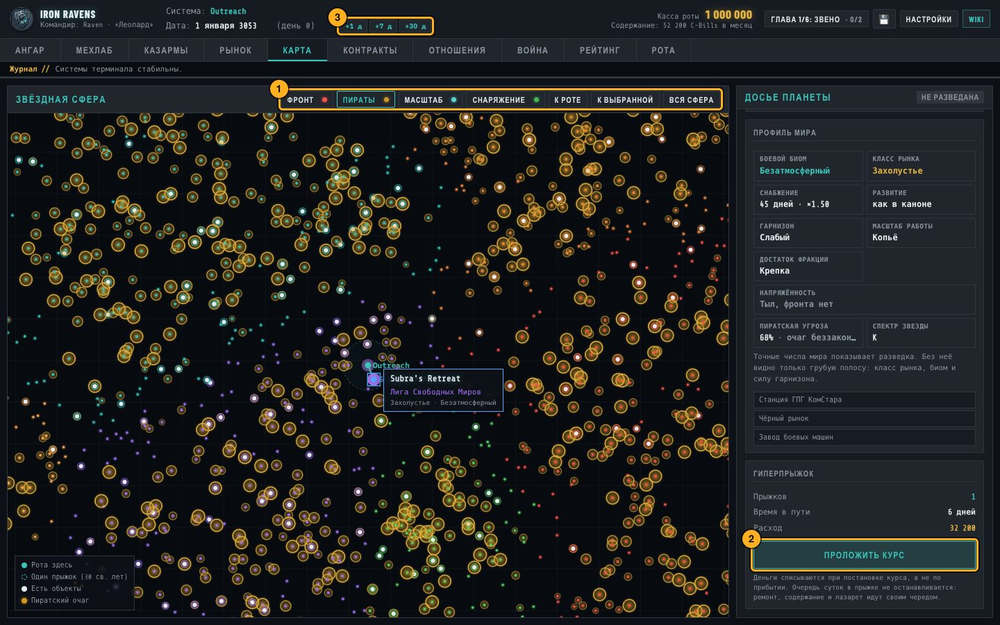

1. **Слои карты**: линия фронта, очаги пиратов, масштаб работы, где снаряжение дешевле. Слой пиратов
   показывает, где есть работа для молодого отряда.
2. **Проложить курс** к выбранному миру: в досье — число прыжков, время в пути и цена.
3. Дальше — кнопкой **+7 д** до прибытия.

### 5. Контракты

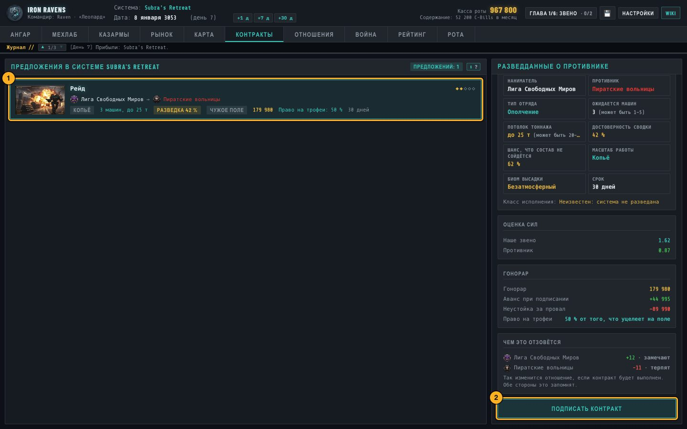

1. **Предложения** в текущей системе: наниматель, противник, гонорар, право на трофеи, срок.
2. **Подписать контракт** — после того как прочитаны разведданные о противнике. Сам бой начинается
   отсюда же, когда звено выведено на поле.

### 6. Бой

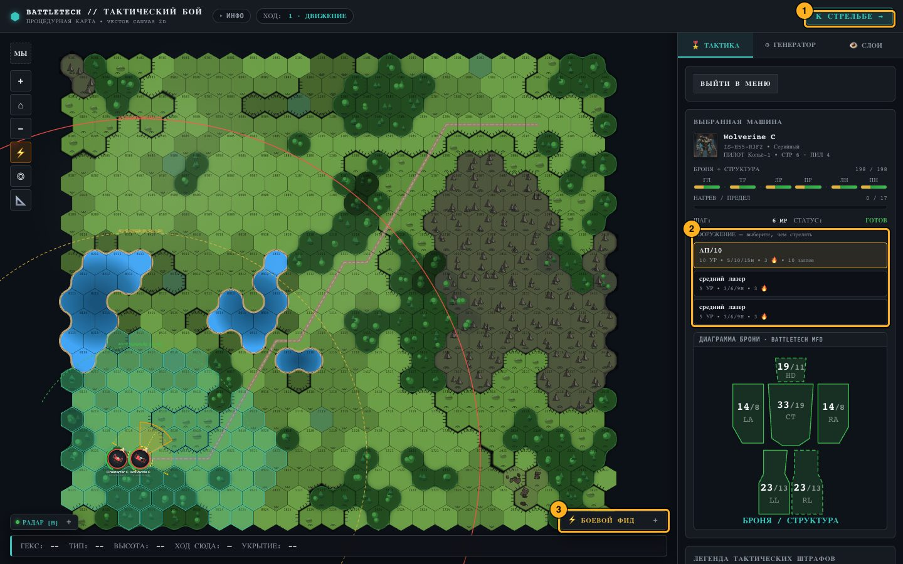

Щёлкните свою машину, затем гекс, куда идти. Лес, вода, холмы и постройки меняют и движение, и
укрытие.

1. **Кнопка фазы**: от движения к стрельбе и дальше, к следующему ходу.
2. **Оружие** выбранной машины: выберите, из чего стрелять, и щёлкните по противнику. У каждого
   ствола видны урон, дальности и нагрев.
3. **Боевой фид** — каждый бросок с разбором: что было нужно, что выпало, куда попало.

### 7. Держава

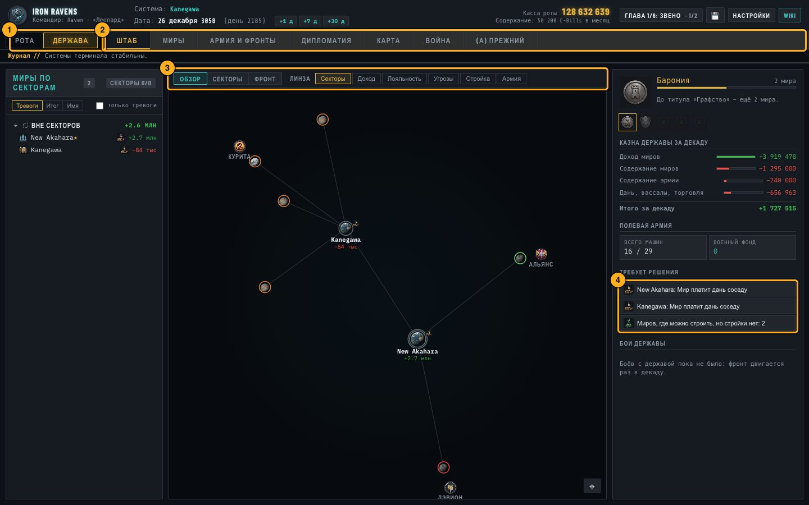

1. **Рота / Держава** — два набора вкладок: дела отряда и дела государства.
2. **Вкладки державы**: штаб, миры, армия и фронты, дипломатия.
3. **Линзы карты**: секторы, доход, лояльность, угрозы, стройка, армия.
4. **Требует решения** — чего держава ждёт от вас прямо сейчас.

## Разработчикам

TypeScript + Vite + Svelte 5 + Canvas 2D, тесты на Vitest. Ядро игры (`game/src/core/`) ничего не
знает об интерфейсе, состояние меняется только командами, все броски идут через сидированный
генератор случайных чисел — поэтому любой бой и любую кампанию можно воспроизвести по сиду.

```bash
cd game
pnpm install
pnpm dev      # игра на http://localhost:5173
pnpm check    # типы, Svelte, линтер и все тесты
```

Нужны Node.js 24 и pnpm 11. Документация: `game_core.md` — архитектура, `wiki/` — игровой дизайн
и правила, `wiki/overview/corridors.md` — баланс, `CLAUDE.md` — правила работы над проектом.
Выкладка игры — `tools/deploy.md`. Снимки экранов выше делает `game/scripts/readme-shots.mjs`.

BattleTech — зарегистрированный товарный знак его владельцев. Это некоммерческий фанатский проект,
никак с ними не связанный и ими не одобренный.
